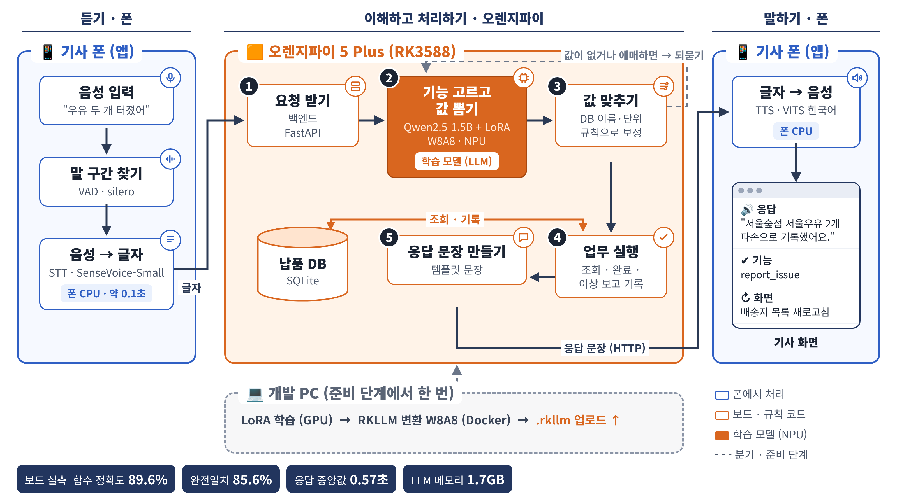

# LogiOn

**말 한마디로 납품 업무를 처리하는 온디바이스 AI 음성 비서 — 편의점 납품기사용, Orange Pi 5 Plus(RK3588) NPU 위에서 동작**

운전 중이거나 양손에 짐을 든 납품기사가 "다음 어디야", "우유 두 개 터졌어" 처럼 말하면, 폰이 알아듣고(STT) 오렌지파이 보드의 AI 가 기능과 값을 골라 배송 DB 를 조회·기록한 뒤 답을 읽어 줍니다(TTS). 인터넷 클라우드 없이 **폰 + 보드 하나**로 돕니다 (PC GPU 모드도 지원).

| 항목 | 내용 |
| --- | --- |
| 과목 | 2026학년도 모바일시스템응용프로젝트 (C분반) |
| 팀 | [8] 2팀 LogiOn |
| 산학 멘토 | 마음AI |

| 역할 | 이름 | GitHub | 담당 |
| --- | --- | --- | --- |
| 팀장 | | | 앱 디자인, 발표 자료 준비 및 발표 |
| AI | | reneejoo22 | 데이터·모델 학습, RKLLM 변환, 보드 배포, 오렌지파이 설정 |
| 백엔드 | | KIMJAESUN | FastAPI·SQLite, 배송 API |
| 앱(프론트) | | yeeun0912 | Android 앱 프론트, STT·TTS 연동 |
| 보드·통합 | | | 미팅 준비 |



## 핵심 결과

test 431건(학습에 쓰지 않은 문장)을 PC 원본 모델과 보드 변환 모델에 똑같이 넣어 비교했습니다. 자세히: [`results/rkllm_board/report.md`](results/rkllm_board/report.md)

| 지표 | PC 원본 (fp16, GPU) | **보드 (RKLLM W8A8, NPU)** |
| --- | ---: | ---: |
| JSON 형식 유효 | 100% | **100%** |
| 기능(함수) 정확도 | 88.6% | **89.6%** |
| 완전 일치 (기능 + 값 모두) | 84.7% | **85.6%** |
| 응답 시간 중앙값 | 317 ms | **574 ms** |
| LLM 메모리 | — | **1.7 GB** (보드 RAM 16GB) |

양자화 후에도 정확도가 떨어지지 않았고(출력이 PC 와 글자까지 같은 비율 97.9%), 보드 하나로 백엔드 + AI 파이프라인 + LLM 이 PC 없이 돌아가는 것을 확인했습니다 ([보드 배포](docs/board_deploy.md)).

## 지원 기능 6개

| 기능 | 예시 발화 | 하는 일 |
| --- | --- | --- |
| `next_stop` | "다음 어디야" | 다음 배송지와 남은 곳 수 안내 |
| `stop_items` | "서울숲점 콜라 몇 박스야" | 점포별 내릴 품목·수량 조회 |
| `complete` | "점장님한테 넘겼어" | 납품 완료 기록 (인수자 포함) |
| `report_issue` | "우유 두 개 터졌어" | 파손·수량부족·오배송·온도이상 기록 (품목이 모호하면 되묻기) |
| `scan` | "바코드 찍을게" | 스캔 화면 열기 |
| `other` | "근처 화장실 어디야" | 업무 밖 요청은 정중히 거절 |

LLM 은 "기능을 고르고 말한 값을 JSON 으로 옮기는 일"만 하고, DB 이름 맞추기·되묻기는 규칙 코드가 맡아 없는 값을 지어내지 않습니다.

## 기술 스택

| 영역 | 사용 기술 |
| --- | --- |
| 앱 (폰) | Kotlin, Jetpack Compose, Retrofit · 음성: sherpa-onnx (silero VAD, SenseVoice-Small int8 STT, 한국어 VITS TTS) |
| 백엔드 (보드) | Python 3.10, FastAPI, SQLite, uvicorn |
| AI 모델 | Qwen2.5-1.5B-Instruct + LoRA (function calling), PyTorch·transformers·peft 로 학습 |
| 보드 추론 | Orange Pi 5 Plus (RK3588), RKLLM 1.3.0 W8A8 변환, NPU 추론 서버 (`rkllm/server/`) |

## 폴더 구조

```
LogiOn/
├─ android/        Android 앱 (화면, 음성 입출력, AI 채팅 탭)
├─ backend/        FastAPI 백엔드 + SQLite 배송 DB (/api/assistant/chat)
├─ demo/           AI 파이프라인 (pipeline.py: LLM 호출 → 값 보정 → 실행 → 응답), 채팅 데모
├─ rkllm/          RKLLM 변환 설정, 보드 LLM 서버 (server/)
├─ scripts/board/  보드 설치·시작/종료 스크립트, systemd, 검증 스크립트
├─ speech/         STT/TTS 모델 받기·시험
├─ config/         파이프라인 설정 (system prompt, 생성 설정, LLM 백엔드)
├─ data/  notebooks/  export/   학습 데이터, 학습·평가 노트북, 변환
├─ results/        평가 결과 (rkllm_board/ = 보드 실측)
└─ docs/           문서 (개발문서 6종: dev_docs/)
```

모델 가중치(`out/`)와 `.rkllm` 파일은 용량 때문에 저장소에 넣지 않습니다.

## 실행 방법

| 방법 | 요약 | 자세히 |
| --- | --- | --- |
| **1. 보드 실행** (기본) | 보드에서 `scripts/board/start_all.sh` → LLM 서버(:8090) + 백엔드(:8000). 앱 `BASE_URL` 을 보드 주소로 | [`docs/board_deploy.md`](docs/board_deploy.md) |
| **2. PC GPU 실행** | `.venv` 에 CUDA torch + `requirements.txt` → `cd backend && uvicorn app.main:app --host 0.0.0.0 --port 8000` | [`docs/ai_details.md` 실행 방법](docs/ai_details.md#실행-방법) |
| **3. 앱·음성 시연** | 에뮬레이터(Pixel_9)에서 앱 실행 → 마이크 켜기(`adb emu avd hostmicon`) → AI 채팅 탭에서 🎤 | [`docs/speech_stt_tts.md`](docs/speech_stt_tts.md), [`docs/ai_details.md` 5절](docs/ai_details.md#5-음성-대화-시연-gpu-서버--에뮬레이터-화면--stttts) |

## 개발문서 6종

| # | 문서 |
| --- | --- |
| 1 | [요구사항 정의서](docs/dev_docs/%5B8%5D2팀%28LogiOn%29%20개발문서1_요구사항정의서.docx) |
| 2 | [아키텍처 설계서](docs/dev_docs/%5B8%5D2팀%28LogiOn%29%20개발문서2_아키텍처설계서.docx) |
| 3 | [모델 설계 및 최적화 문서](docs/dev_docs/%5B8%5D2팀%28LogiOn%29%20개발문서3_모델설계및최적화문서.docx) |
| 4 | [API 및 인터페이스 정의서](docs/dev_docs/%5B8%5D2팀%28LogiOn%29%20개발문서4_API및인터페이스정의서.docx) |
| 5 | [테스트 계획서 및 결과 보고서](docs/dev_docs/%5B8%5D2팀%28LogiOn%29%20개발문서5_테스트계획서및결과보고서.docx) |
| 6 | [배포 및 통합 가이드](docs/dev_docs/%5B8%5D2팀%28LogiOn%29%20개발문서6_배포및통합가이드.docx) |

## 더 볼 문서

| 문서 | 내용 |
| --- | --- |
| [`docs/ai_details.md`](docs/ai_details.md) | AI 파트 상세: 데이터 설계, 모델 선택, v1→v2→v3 평가, 틀린 예시 분석, 실행 방법 전체 |
| [`docs/board_deploy.md`](docs/board_deploy.md) | 보드 배포: 구조, 켜고 끄기, 로그, 폰 연결(USB 테더링·공유기), 문제 해결 |
| [`results/rkllm_board/report.md`](results/rkllm_board/report.md) | 보드 LLM 검증: 431건 PC 대비, 함수별, 속도·메모리 |
| [`docs/rkllm_convert.md`](docs/rkllm_convert.md) | RKLLM W8A8 변환 절차 |
| [`docs/speech_stt_tts.md`](docs/speech_stt_tts.md) | 앱 음성(STT·TTS) 설계와 측정 |
| [`backend/README.md`](backend/README.md) | 백엔드 API·구조 |
| [`results/single_llm_report.md`](results/single_llm_report.md) | 단일 모델 구조 선택 근거 |
