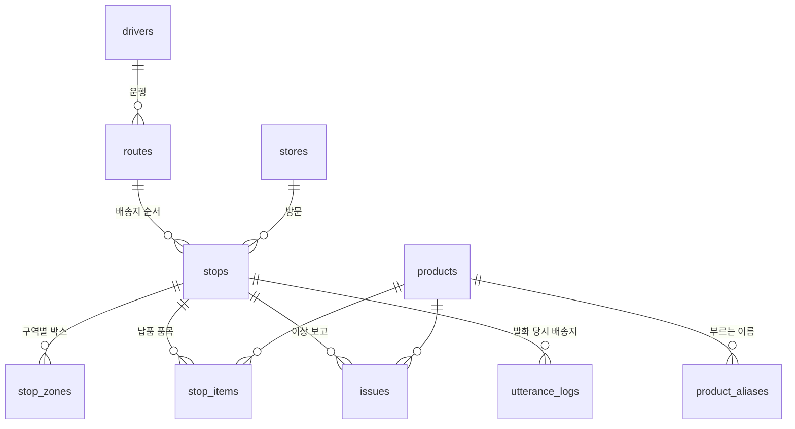

# LogiOn 데이터베이스 설계

## 1. 전제

| 항목 | 결정 | 이유 |
| --- | --- | --- |
| 위치 | Orange Pi 위 로컬 DB | 인터넷 없이 동작해야 하고, 음성 파이프라인(STT·LLM·TTS)이 보드에 있음 |
| 엔진 | SQLite 파일 1개 (`backend/data/logion.db`) | 기사 1명·차량 1대 규모, 별도 DB 서버 불필요 |
| 접근 | 앱은 DB에 직접 붙지 않고 보드의 API 서버를 거침 | 화면 조작과 음성 명령이 같은 데이터를 보게 하려면 창구가 하나여야 함 |

첫 작업 목표는 **"데이터를 앱에서 볼 수 있도록"** 이므로, 이 문서는 앱 화면이 지금 Mock으로 그리고 있는 값을 전부 DB에서 꺼낼 수 있게 하는 데 맞춰져 있습니다. 음성 기능 6개(`next_stop`, `stop_items`, `complete`, `report_issue`, `scan`, `other`)도 같은 테이블로 처리됩니다.

SQLite 설정: `PRAGMA foreign_keys = ON`, `PRAGMA journal_mode = WAL`. 시각은 ISO 8601 문자열(`2026-10-12T10:25:00`)로 저장합니다.

## 2. 테이블 관계



| 테이블 | 성격 | 한 줄 설명 |
| --- | --- | --- |
| `drivers` | 기준 정보 | 기사 |
| `stores` | 기준 정보 | 편의점 점포 |
| `products` | 기준 정보 | 납품 품목 |
| `product_aliases` | 기준 정보 | 품목을 부르는 여러 이름 (음성 보정용) |
| `routes` | 당일 계획 | 기사 한 명의 하루 운행 |
| `stops` | 당일 계획 + 상태 | 운행 안의 배송지 한 곳 |
| `stop_zones` | 당일 계획 + 상태 | 배송지의 구역별 박스 수와 확인 여부 |
| `stop_items` | 당일 계획 | 배송지에 내릴 품목과 수량 |
| `issues` | 기록 | 이상 보고 |
| `utterance_logs` | 기록 | 음성 발화 처리 내역 |

## 3. 테이블 정의

### 3-1. 기준 정보

```sql
CREATE TABLE drivers (
    id             INTEGER PRIMARY KEY,
    name           TEXT NOT NULL,              -- 김도윤
    area           TEXT NOT NULL,              -- 성수 2권역
    vehicle_number TEXT NOT NULL               -- 82허 4210
);

CREATE TABLE stores (
    id         INTEGER PRIMARY KEY,
    name       TEXT NOT NULL,                  -- GS25 성수연무장점 (화면 표시용)
    short_name TEXT NOT NULL UNIQUE,           -- 성수연무장점 (음성 인식·응답용)
    address    TEXT NOT NULL,
    phone      TEXT,                           -- 상세 화면 "매장 연락"
    lat        REAL,                           -- "길 안내", "배송지 위치 보기"
    lng        REAL
);

CREATE TABLE products (
    id       INTEGER PRIMARY KEY,
    name     TEXT NOT NULL UNIQUE,             -- 서울우유
    category TEXT NOT NULL
             CHECK (category IN ('tobacco', 'ambient_drink', 'chilled', 'ready_meal')),
    barcode  TEXT UNIQUE                       -- 스캔 화면에서 조회
);

CREATE TABLE product_aliases (
    product_id INTEGER NOT NULL REFERENCES products(id),
    alias      TEXT NOT NULL,                  -- 공백 제거한 형태로 저장: "우유"
    PRIMARY KEY (product_id, alias)
);
CREATE INDEX idx_alias ON product_aliases(alias);
```

`category` 값과 앱 화면의 구역 이름 대응: `tobacco` 담배류, `ambient_drink` 상온 음료, `chilled` 냉장 상품, `ready_meal` 간편식.

`product_aliases.alias`는 일부러 유일하지 않습니다. "삼각김밥"이 참치삼각김밥·스팸마요삼각김밥 두 줄에 걸리면 그게 곧 되묻기 대상입니다. ("우유"는 별칭으로는 서울우유 하나지만, 값 보정 규칙이 이름에 "우유"가 들어간 품목도 함께 후보로 잡아 되묻게 됩니다.)

### 3-2. 당일 계획과 상태

```sql
CREATE TABLE routes (
    id           INTEGER PRIMARY KEY,
    driver_id    INTEGER NOT NULL REFERENCES drivers(id),
    service_date TEXT NOT NULL,                -- 2026-10-12
    depart_at    TEXT,                         -- 홈 화면 "출발 09:40"
    est_end_at   TEXT,                         -- 홈 화면 "예상 종료 12:05"
    synced_at    TEXT,                         -- 배송목록 "마지막 동기화 09:38"
    UNIQUE (driver_id, service_date)
);

CREATE TABLE stops (
    id           INTEGER PRIMARY KEY,
    route_id     INTEGER NOT NULL REFERENCES routes(id),
    store_id     INTEGER NOT NULL REFERENCES stores(id),
    seq          INTEGER NOT NULL,             -- 방문 순서 (1부터)
    eta          TEXT NOT NULL,                -- 도착 예정 시각
    distance_km  REAL,                         -- 이전 지점에서의 계획 거리
    notice       TEXT,                         -- "냉장 상품 4박스가 별도 구역에 있습니다."
    status       TEXT NOT NULL DEFAULT 'pending'
                 CHECK (status IN ('pending', 'done')),
    completed_at TEXT,
    receiver     TEXT,                         -- 인수자: 점장님
    updated_at   TEXT NOT NULL,
    UNIQUE (route_id, seq),
    UNIQUE (route_id, store_id)
);

CREATE TABLE stop_zones (
    stop_id    INTEGER NOT NULL REFERENCES stops(id),
    category   TEXT NOT NULL
               CHECK (category IN ('tobacco', 'ambient_drink', 'chilled', 'ready_meal')),
    boxes      INTEGER NOT NULL DEFAULT 0,     -- 상세 화면 "4박스"
    checked    INTEGER NOT NULL DEFAULT 0,     -- 0/1, "확인" / "확인 필요"
    updated_at TEXT NOT NULL,
    PRIMARY KEY (stop_id, category)
);

CREATE TABLE stop_items (
    id         INTEGER PRIMARY KEY,
    stop_id    INTEGER NOT NULL REFERENCES stops(id),
    product_id INTEGER NOT NULL REFERENCES products(id),
    qty        INTEGER NOT NULL,
    unit       TEXT NOT NULL CHECK (unit IN ('개', '박스', '판', '봉지')),
    UNIQUE (stop_id, product_id)
);
```

### 3-3. 기록

```sql
CREATE TABLE issues (
    id         INTEGER PRIMARY KEY,
    stop_id    INTEGER NOT NULL REFERENCES stops(id),
    product_id INTEGER REFERENCES products(id),
    type       TEXT NOT NULL
               CHECK (type IN ('파손', '수량부족', '오배송', '온도이상')),
    qty        INTEGER,
    unit       TEXT CHECK (unit IN ('개', '박스', '판', '봉지')),
    source     TEXT NOT NULL CHECK (source IN ('voice', 'touch')),
    created_at TEXT NOT NULL
);

CREATE TABLE utterance_logs (
    id          INTEGER PRIMARY KEY,
    stop_id     INTEGER REFERENCES stops(id),  -- 발화 당시 현재 배송지
    text        TEXT NOT NULL,                 -- STT 결과
    intent      TEXT,                          -- 의도분류 결과
    intent_conf REAL,
    llm_raw     TEXT,                          -- LLM 출력 원문 (LLM을 건너뛰면 NULL)
    resolved    TEXT,                          -- 값 보정 후 실행 내용 JSON
    reply       TEXT,                          -- 응답 문장
    latency_ms  INTEGER,
    created_at  TEXT NOT NULL
);
```

## 4. 설계 판단

**"다음 배송"은 저장하지 않는다.** 앱은 지금 `status`에 "다음 배송"/"예정" 문자열을 넣어두지만, DB에는 `pending`/`done`만 둡니다. 다음 배송지는 `pending` 중 `seq`가 가장 작은 곳으로 계산합니다. 저장해 두면 완료·완료 취소 때마다 여러 행을 같이 고쳐야 하고 어긋나기 쉽습니다.

**점포 이름은 두 개.** 화면은 "GS25 성수연무장점"을, 음성은 "성수연무장점"을 씁니다. 값 보정 단계는 `short_name`만 대상으로 비교합니다.

**구역(`stop_zones`)과 품목(`stop_items`)을 따로 둔다.** 앱의 상품 확인은 구역 4개를 박스 단위로 체크하고, 음성의 `stop_items`는 "콜라 몇 박스야"처럼 품목 단위로 묻습니다. 박스 수와 품목 수량은 서로 계산되지 않는 값이라 테이블을 나눴습니다. 배송지의 전체 박스 수("박스 12개")는 `stop_zones.boxes` 합계로 구합니다.

**값 보정 후보는 오늘 경로로 좁힌다.** 노트북은 점포 24곳·품목 20개 전체를 대상으로 이름을 맞추지만, 실제로는 오늘 `stops`에 있는 점포와 현재 배송지의 `stop_items`에 있는 품목만 후보로 삼으면 됩니다. 후보가 줄어 되묻기가 줄어듭니다.

**되묻기 대기 상태는 DB에 넣지 않는다.** "어떤 품목인가요?"를 묻고 답을 기다리는 상태는 수 초짜리라 서버 메모리에 둡니다.

**완료 취소를 지원한다.** 앱에 "배송 완료 취소"가 있으므로 `stops` 행을 지우지 않고 `status`를 되돌리고 `completed_at`·`receiver`를 비웁니다. 해당 배송지의 `stop_zones.checked`도 0으로 되돌립니다.

**`updated_at`을 둔다.** 앱에 "오프라인 작업 큐", "마지막 동기화" 문구가 있어, 나중에 변경분만 주고받을 수 있게 상태가 바뀌는 테이블에 넣었습니다.

## 5. 앱 화면과 데이터 대응

| 화면 | 표시 내용 | 출처 |
| --- | --- | --- |
| 홈 | 기사 이름, 이니셜 | `drivers.name` (이니셜은 이름에서 계산) |
| 홈 | 오늘 배송 n / 전체, 완료율 | `stops`의 `status` 집계 |
| 홈 | 출발, 예상 종료 | `routes.depart_at`, `est_end_at` |
| 홈 | 다음 배송지 이름, 도착 예정, 거리, 박스 수 | `pending` 중 첫 `stops` + `stores` + `stop_zones` 합계 |
| 홈 | 배송 전 확인 안내 | `stops.notice` |
| 배송목록 | 전체 / 진행 중 / 완료 목록 | `stops` + `stores`, `seq` 순 |
| 배송목록 | 마지막 동기화 | `routes.synced_at` |
| 배송지 상세 | 이름, 주소, 매장 연락, 길 안내 | `stores` |
| 배송지 상세 | 구역별 박스 수, 확인 여부 | `stop_zones` |
| 배송지 상세 | 배송 완료 / 완료 취소 | `stops.status` |
| 스캔 | 바코드로 품목 찾기 | `products.barcode` |
| 스캔 | 이상 보고 | `issues` |
| 더보기 | 권역, 차량 번호 | `drivers` |

## 6. 음성 기능과 데이터 대응

| 함수 | 읽는 곳 | 쓰는 곳 |
| --- | --- | --- |
| `next_stop` | `stops` (`pending`, `seq` 순) | 없음 |
| `stop_items` | `stop_items` + `products` | 없음 |
| `complete` | `stops` | `stops.status`, `completed_at`, `receiver` |
| `report_issue` | `stops`, `products`, `product_aliases` | `issues` |
| `scan` | 없음 (앱에 스캔 화면을 열라는 신호만 보냄) | 없음 |
| `other` | 없음 | 없음 |

모든 발화는 처리 결과와 함께 `utterance_logs`에 남깁니다. 실제 기사 음성으로 정확도를 재거나 재학습 데이터를 모을 때 씁니다.

## 7. 초기 데이터

`backend/app/db/seed.py`에서 넣습니다.

- 기사 1명, 점포 3곳: 앱의 `MockUser.kt`, `MockDat.kt` 값 그대로
- 품목 20개와 별칭: AI 노트북의 `ITEM_FORMS`
- 오늘 날짜의 운행 1건, 배송지 3곳, 구역별 박스 수, 배송지별 품목
- 점포 전화번호·좌표와 품목 바코드는 실제 값이 아닌 임시 값

## 8. 팀과 맞춰야 할 것

| 항목 | 현재 상태 | 제안 |
| --- | --- | --- |
| 이상 유형 | 앱 스캔 화면은 "파손 · 수량 불일치 · 누락", AI는 "파손 · 수량부족 · 오배송 · 온도이상" | AI 쪽 4개로 통일 (모델이 이 값으로 학습됨) |
| 점포 이름 | 앱은 성수 권역 3곳, AI 학습 데이터는 "역삼점" 등 24곳 | 시연용 점포를 한쪽으로 통일. 모델은 문장에 나온 점포 이름을 그대로 옮기므로 재학습 없이 될 가능성이 높지만 확인 필요 |
| 품목 구역 | 앱은 "담배류"가 있는데 AI 품목 20개에는 담배가 없음. 반대로 과자·컵라면은 맞는 구역이 없어 시드에서는 "간편식"에 넣어둠 | 품목 목록에 담배류를 추가하고, 구역에 "상온 식품"을 추가하거나 이름을 조정 |
| 거리 | 앱은 "도착까지 1.8 km" | 우선 계획 거리(`distance_km`)를 표시하고, 실시간 거리는 앱 GPS로 나중에 계산 |
