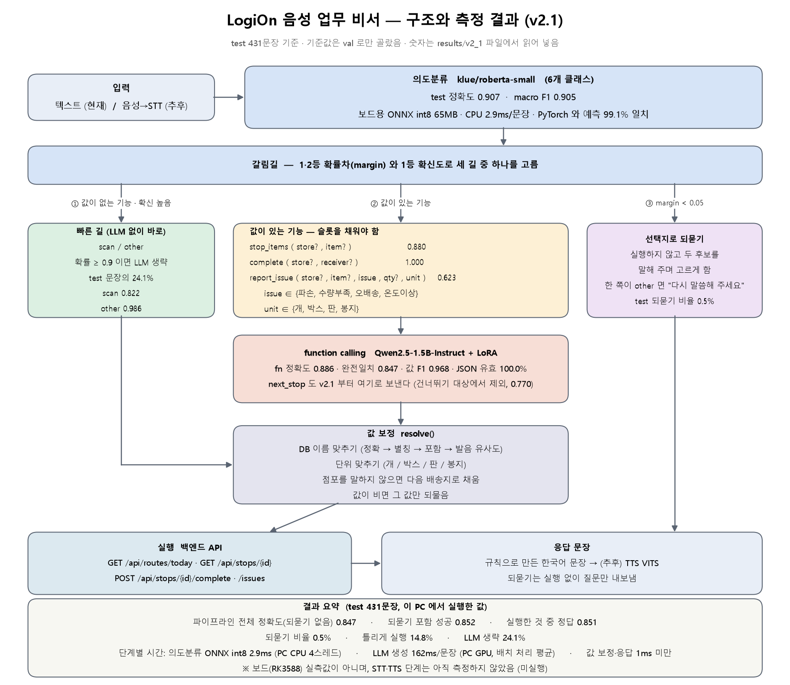

# LogiOn AI 파트 — 1차 보고 정리

2026-10-24 / 브랜치 `ai-improve-1022` / **모든 수치는 실제 실행 결과**입니다. 돌리지 못한 것은 **미실행**으로 적었습니다.

> 이 문서는 2026-10-24 시점(v2.1, 의도분류 포함) 기록입니다. 이후 의도분류를 뺀 단일 모델 구조(v3-single)로 단순화했습니다 — [`results/single_llm_report.md`](../results/single_llm_report.md).

---

## 1. 이번에 한 일 (v1 → v2 → v2.1)

| # | 한 일 | 결과 |
| --- | --- | --- |
| 1 | **라벨 버그 수정** | 말에는 수량이 있는데 정답에 `qty` 가 없던 report_issue 문장 **27건 → 0건** |
| 2 | **수사·단위 처리 정리** | "두 박스"/"박스 하나"/"둘"/"하나 빠졌어" 를 규칙으로 구분. 단위는 개·박스·판·봉지로 통일 |
| 3 | **선택지로 되묻기** | margin < τ 면 실행하지 않고 두 후보를 말해 주며 고르게 함. "배송지"/"물건"/"첫 번째" 같은 답을 이어받음 |
| 4 | **기준값 재선정 (v2.1)** | τ 와 LLM 건너뛰기 기준을 **val 로만** 다시 고름 → `next_stop` 을 건너뛰기 대상에서 제외 |
| 5 | **모델 조합 선정** | 의도분류 v1/v2 × FC v1/v2 네 조합을 val 로 비교 → v2+v2 |
| 6 | **ONNX 변환** | 의도분류 260MB → **65MB**, CPU 15.1ms → **2.9ms/문장**, 예측 99.07% 일치 |
| 7 | **보드 스크립트** | RKLLM 변환 · 보드 평가 · 단계별 지연 측정 스크립트 (**변환·측정은 미실행**) |
| 8 | **백엔드 연결 가이드** | [`backend_integration.md`](backend_integration.md) — 코드는 고치지 않고 문서만 |
| 9 | **데모 노트북** | [`LogiOn_demo_pipeline.ipynb`](../notebooks/LogiOn_demo_pipeline.ipynb) — 한 문장이 거치는 단계를 모두 펼쳐 보여 줌 |
| 10 | **구조 그림** | [`architecture.png`](architecture.png) — 숫자는 결과 파일에서 읽어 자동 생성 |

---

## 2. v1 / v2 / v2.1 비교 (같은 test 431문장)

틀 배정은 v1 것을 고정해 썼습니다. v1 의 train·val 문장과 겹친 test 문장은 **0건**입니다.

| 지표 | v1 | v2 | v2.1 |
| --- | --- | --- | --- |
| **의도분류** 정확도 | 0.893 | **0.907** | **0.907** |
| 의도분류 macro F1 | 0.895 | **0.905** | **0.905** |
| **function calling** JSON 유효율 | 1.000 | 1.000 | 1.000 |
| fn 정확도 | **0.916** | 0.886 | 0.886 |
| 완전일치 | **0.896** | 0.847 | 0.847 |
| 값 F1 | **0.976** | 0.968 | 0.968 |
| 최종동작일치 | **0.898** | 0.847 | 0.847 |
| **파이프라인** 전체 정확도(되묻기 없음) | **0.937** | 0.845 | 0.847 |
| 되묻기 포함 성공 | **0.903** | 0.849 | 0.852 |
| 실행한 것 중 정답 | **0.933** | 0.848 | 0.851 |
| 틀리게 실행한 비율 | **0.063** | 0.151 | 0.148 |
| **되묻기** 비율 | 0.065 | 0.005 | 0.005 |
| **LLM 생략 비율** | 0.353 | 0.455 | **0.241** |

**정리**: 의도분류는 올랐고(+0.014), function calling 은 내려갔습니다(−0.051). v2.1 은 v2 대비 +0.002 입니다.
v2.1 은 `next_stop` 을 LLM 으로 보내서 **잘못된 즉시 실행을 줄인 대신 LLM 호출이 55% → 76% 로 늘었습니다.** 정확도와 속도의 교환입니다.

### 기능별 (v2.1, test)

| 기능 | n | FC 최종동작일치 | 되묻기 | 바로 맞게 실행 | 틀리게 실행 |
| --- | --- | --- | --- | --- | --- |
| complete | 70 | **1.000** | 0.000 | 1.000 | 0.000 |
| other | 70 | 0.986 | 0.000 | 0.986 | 0.014 |
| stop_items | 75 | 0.880 | 0.013 | 0.880 | 0.107 |
| scan | 73 | 0.822 | 0.014 | 0.822 | 0.164 |
| next_stop | 74 | 0.770 | 0.000 | 0.770 | 0.230 |
| report_issue | 69 | **0.623** | 0.000 | 0.623 | 0.377 |

---

## 3. v2 에서 떨어진 이유와 찾은 과정

### 찾은 과정

1. v1 오답 57건을 **원인별로 분류**했습니다 → 11건(19%)이 모델이 아니라 **데이터 잘못**(라벨 버그)이었습니다.
2. 그 라벨을 고치고 재학습했더니 **의도분류는 올랐는데 FC 가 내려갔습니다.**
3. v1 과 v2 가 **같은 test 에서 다르게 답한 문장 52건**을 하나씩 비교했습니다 (v1만 맞춤 37 / v2만 맞춤 15).
4. 37건 중 **25건이 딱 두 개의 말 틀**에서 나왔습니다.

### 원인 A — 라벨 수정의 예견된 부작용 (17건)

| | |
| --- | --- |
| 틀 | `{item} 박스 하나 {issue}` |
| 무엇 | 1단계에서 이 틀의 정답을 `qty:1, unit:"박스"` 로 고쳤음 (test 숫자를 보기 전에 기록됨) |
| 문제 | 이 틀이 **train 0건 / test 17건**. 동시에 "하나 → 단위 없음" 규칙을 넣어서, v2 는 "박스 하나" 를 못 배운 채 `unit` 을 빼먹음 |
| 결과 | v1 13/17 → **v2 1/17** |

예: `제육도시락 박스 하나 다 녹았어` → 정답 `qty:1, unit:"박스"` / v1 `qty:1, unit:"박스"` ✅ / v2 `qty:1` ❌

### 원인 B — 설명하지 못한 일반화 손실 (13건)

| | |
| --- | --- |
| 틀 | `물건 확인할게` (정답 `scan`) |
| 문제 | v2 가 13건 전부 `stop_items` 라고 답함. v1 은 13/13 맞힘. 이 틀도 train 0건 / test 13건 |
| 상태 | **원인 미확정. 미해결로 남김** |

### report_issue — 라벨 버그를 없앤 맞교환

| | v1 | v2 |
| --- | --- | --- |
| report_issue 오답 | 24건 | 26건 |
| 그중 **라벨 버그** | **11건** | **0건** |
| 그중 수량·단위 생성 | 2건 | 16건 (= 원인 A) |
| 그중 본질적 모호성 | 9건 | 9건 |

**데이터 잘못은 완전히 없앴고, 남은 것은 학습 데이터 커버리지 문제**입니다.

---

## 4. 기준값을 다시 고르면서 알게 된 것

### 4-1. 되묻기 τ — **지난 보고에서 한 말을 정정합니다**

지난번에 "실행 정확도 기준으로 고르면 τ≈0.4~0.5 가 뽑힌다" 고 했는데, 그 수치는 **의도분류 라벨만으로 계산한 것**이었습니다.
실제 파이프라인(실행 결과가 정답과 같은지)으로 다시 재니 **반대**였습니다.

| val τ | 되묻기 비율 | 실행 정확도 | 틀리게 실행 | 되묻기 포함 파이프라인 |
| --- | --- | --- | --- | --- |
| 0.00 | 0.0% | 0.9582 | 0.0418 | 0.9582 |
| **0.05 (선택)** | 0.3% | 0.9581 | 0.0418 | 0.9582 |
| 0.20 | 2.6% | 0.9571 | 0.0418 | 0.9373 |
| 0.50 | 6.3% | 0.9554 | 0.0418 | 0.9086 |

**τ 를 올려도 "틀리게 실행한 비율" 이 전혀 줄지 않습니다(0.0418 고정).** τ 가 걸러내는 문장은 어차피 뒤의 LLM 이 바로잡던 문장들이기 때문입니다.
→ **두 기준 모두 τ=0.05 를 고릅니다.** 되묻기가 거의 안 걸리는 것은 기준이 잘못돼서가 아니라, **지금 구조에서는 margin 이 작다고 되물어도 얻는 게 없기 때문**입니다.

### 4-2. LLM 건너뛰기 — `next_stop` 제외

| 설정 (val) | 실행 정확도 | 되묻기 포함 파이프라인 | LLM 생략 |
| --- | --- | --- | --- |
| next_stop 포함, 기준 0.90 (= v2) | 0.9581 | 0.9582 | 40.7% |
| **next_stop 불포함, 기준 0.90 (선택)** | **0.9686** | **0.9687** | 26.4% |

의도분류가 `other` 70건 중 **24건을 `next_stop` 으로** 잘못 봅니다("근처 화장실 어디야"). 건너뛰기 대상이면 그대로 잘못 실행되지만, LLM 으로 보내면 바로잡힙니다.
(데모 노트북의 "지금 몇 시야" 가 실제 사례입니다: 의도분류 `next_stop` 0.849 → LLM 이 `other` 로 정정)

### 4-3. **val 과 test 가 반대로 말합니다 — 새 test 세트가 필요한 이유**

| | val 1위 | test 1위 |
| --- | --- | --- |
| 모델 조합 | **v2 + v2** (0.9687) | **v1 + v1** (0.903) |

원인 A·B 의 두 틀이 **test 에만 있고 val 에는 한 줄도 없습니다**(각각 17건·13건, train·val 0건).
즉 **val 만 보고 고르면 이 회귀를 볼 수 없습니다.** 규칙대로 val 로만 골랐고, 그 결과가 test 에서 뒤집히는 것을 그대로 기록합니다.

---

## 5. 남은 문제

| 문제 | 상태 |
| --- | --- |
| 원인 A (`박스 하나` 틀이 test 에만 있음) | 고치는 방법은 알고 있음. **이번에는 고치지 않음** — v2 의 test 오답을 보고 데이터 규칙을 바꾸면 test 에 맞춰 조정하는 셈이 되기 때문 |
| 원인 B (`물건 확인할게` → scan 을 놓침) | **원인 미확정** |
| 되묻기가 거의 발동하지 않음 | 기준 문제가 아님이 확인됨 (4-1). 다른 방식이 필요 |
| report_issue 정확도 0.623 | 가장 어려운 기능. 수량·단위와 본질적 모호성이 섞여 있음 |
| 점포 이름이 DB 와 다름 | 학습 데이터(역삼점 등) ≠ DB(성수연무장점 등). [연결 가이드 3-3](backend_integration.md) 참고 |
| 모든 평가가 텍스트 입력 | STT 를 거친 실제 음성으로는 아직 측정 못 함 |
| 속도는 PC 기준 | 보드(RK3588) 실측값 없음 |

---

## 6. 다음 계획

| 순서 | 할 일 | 누가 |
| --- | --- | --- |
| 1 | **새 test 세트로 검증** — 지금 test 는 특정 틀이 한쪽에 몰려 있어 판단을 왜곡함. 틀을 고르게 섞은 새 평가 세트를 만들고, 그 위에서 원인 A 수정안(`{qty}` 를 "박스 하나" 같은 단위-먼저 형태로도 학습에 넣기)을 검증 | AI |
| 2 | **원인 B 규명** | AI |
| 3 | **RKLLM 변환 (W8A8)** — x86 Linux + rkllm-toolkit 필요. 준비 단계(캘리브레이션 450건, max_context 256, eos 151645)는 확인 완료 | AI (환경 필요) |
| 4 | **보드 실측** — `scripts/board_eval.py`, `scripts/board_latency.py` 로 정확도·단계별 지연 측정 | AI + 보드 |
| 5 | **실제 음성 평가** — 기사 목소리 녹음으로 STT→파이프라인 전 구간 | AI + 보드 |
| 6 | **앱 채팅 탭 연동** — `POST /api/assistant/chat` 제안 명세대로 | **앱 / 백엔드 담당** |

---

## 7. 보드 변환·측정 현황

| | 상태 |
| --- | --- |
| 의도분류 ONNX (fp32/int8) | **완료** — int8 65MB, CPU 2.9ms/문장, PyTorch 와 예측 99.07% 일치 |
| RKLLM W8A8 변환 | **미실행** — 이 PC 에 rkllm-toolkit 없음 (x86 Linux 전용, WSL·Docker·휠 모두 없음). 스크립트와 실행 순서는 준비됨 |
| 보드 LLM 평가 | **미실행** — 보드 주소 없음, `.rkllm` 파일 없음. 가짜 서버로 코드 동작만 확인 |
| 단계별 지연 측정 | **미실행** — 보드와 STT·TTS 모델 없음 |

---

## 부록 — 파일 위치

| | |
| --- | --- |
| 선택된 설정 | [`config/pipeline_v2_1.json`](../config/pipeline_v2_1.json) |
| v2.1 결과 | [`results/v2_1/`](../results/v2_1/) (`test_summary.json`, `comparison_v1_v2_v21.csv`, `val_grid.csv`) |
| v2 결과·원인 분석 | [`results/v2/`](../results/v2/) (`error_causes.csv`, `error_examples_v2.csv`) |
| v1 결과 (보존) | [`results/v1/`](../results/v1/) |
| 작업 기록·판단 근거 | [`logs/ai-improve-1022.md`](../logs/ai-improve-1022.md) |
| 중간 정리 (v1→v2 상세) | [`midterm_ai_summary.md`](midterm_ai_summary.md) |
