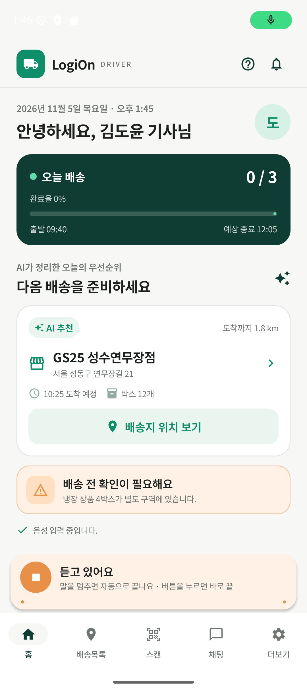
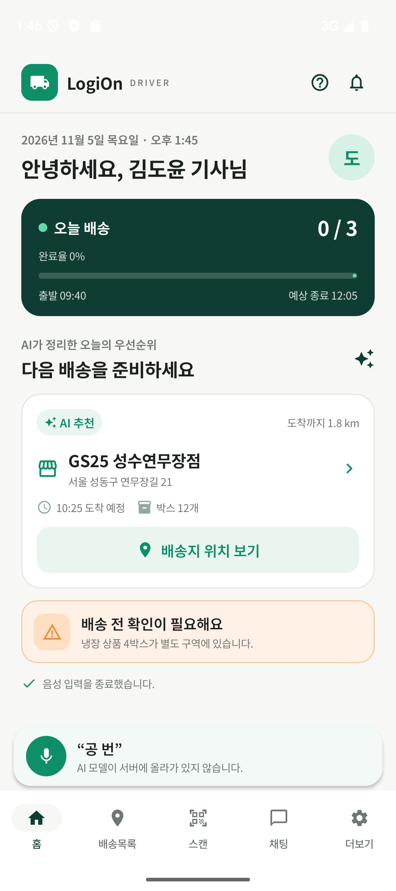

# STT·TTS(음성 인식·음성 합성) 붙이기 — 작업 전체 정리

- 작성일: 2026-11-05
- 기준: `origin/main` = `5e9d7cd` (Merge branch 'backend-assistant-chat') — **아직 커밋하지 않은 상태**의 변경을 정리
- 참고 자료
  - 「[마음AI] 한성대학교 특강3(양자화, Agent) 자료.pdf」 — 이하 **강의 PDF** (p.15~24 가 이번 작업과 관련)
  - 「[8] 2팀 LogiOn 중간 평가.pdf」 — 이하 **중간평가 PDF** (p.10 다음 계획)

이 문서만 읽고 "무엇을, 왜, 어떻게 바꿨는지, 강의와 무엇이 같고 다른지, origin 과 무엇이 다른지" 를 설명할 수 있게 쓰는 것이 목표입니다.

---

## 목차

0. [한눈에 보기](#0-한눈에-보기)
1. [배경 지식 — 이해하기 위한 설명](#1-배경-지식--이해하기-위한-설명)
2. [강의 PDF 와 같은 점 / 다른 점](#2-강의-pdf-와-같은-점--다른-점)
3. [작업 과정 (순서대로, 막힌 곳 포함)](#3-작업-과정-순서대로-막힌-곳-포함)
4. [origin 대비 변경 내역 (파일별 상세)](#4-origin-대비-변경-내역-파일별-상세)
5. [모델·라이브러리가 어디에 있나](#5-모델라이브러리가-어디에-있나)
6. [동작 흐름 — 🎤 누르고 답을 듣기까지](#6-동작-흐름--누르고-답을-듣기까지)
7. [사용법](#7-사용법)
8. [확인 결과 (실제로 돌린 것)](#8-확인-결과-실제로-돌린-것)
9. [한계 · 주의 · 남은 일](#9-한계--주의--남은-일)
10. [예상 질문과 답](#10-예상-질문과-답)

---

## 0. 한눈에 보기

| | 목표 | 한 일 |
| --- | --- | --- |
| 목표 1 | 아무 텍스트/음성에 쓸 수 있는 STT·TTS 환경 | **PC(파이썬)**: `speech/speech_engine.py` + 명령줄 `speech/cli.py`<br>**안드로이드**: `speech/SpeechEngine.kt` (어느 화면에서나 `listen/transcribe/speak`) |
| 목표 2 | LogiOn 앱에서 기사와 **말로** 대화 | 🎤 → 폰 안에서 VAD+STT → 백엔드 AI(`/api/assistant/chat`) → 답 화면 표시 + 폰 안에서 TTS 로 읽기 |

- **쓴 라이브러리**: sherpa-onnx **1.13.8** (파이썬·안드로이드 모두. 2.x 는 한국어 TTS 불가 → [3-4](#3-4-막힌-곳-sherpa-onnx-2x-에서-한국어-tts-가-안-됨))
- **쓴 모델 3개**: VAD `silero_vad.onnx` / STT `SenseVoice-Small int8` / TTS `vits-mimic3-ko_KO-kss_low`
- **백엔드 코드는 한 줄도 안 바꿈.** 기존 `/api/assistant/chat` 의 `reply` 를 그대로 TTS 로 읽음.
- **AI 모델(의도분류, Qwen)·학습 데이터·노트북도 안 바꿈.**
- 모델 파일·AAR 은 **git 에 안 올라감** (약 600MB). `python speech/download_models.py` 로 받음.

---

## 1. 배경 지식 — 이해하기 위한 설명

강의 PDF 에 있는 내용이지만, 이번 작업을 이해하는 데 필요한 것만 다시 풀어 씁니다.

### 1-1. 각 단계가 하는 일

| 용어 | 하는 일 | 비유 |
| --- | --- | --- |
| **VAD** (Voice Activity Detection) | 마이크 소리 중 **사람이 말한 구간만** 잘라 냄. 말을 멈추면 "끝났다" 를 알려 줌 | 녹음 버튼을 대신 눌렀다 떼 주는 사람 |
| **STT** (Speech-To-Text, ASR) | 잘라 낸 음성 → 글자 | 받아쓰기 |
| **TTS** (Text-To-Speech) | 글자 → 음성 | 읽어 주기 |
| **LLM / 의도분류** | 글자의 뜻을 이해하고 할 일 결정 | (우리 프로젝트에선 백엔드가 담당) |

VAD 가 없으면 "버튼 누르고 → 말하고 → 다시 눌러야" 하고, 조용한 구간까지 STT 에 넣어 느려지고 엉뚱한 글자가 나옵니다.

### 1-2. sherpa-onnx 란 (강의 p.18)

- 음성 AI 모델(STT/TTS/VAD/화자인식 등)을 **ONNX 형식**으로 돌려 주는 오픈소스 프레임워크 (k2-fsa).
- 안에서는 ONNX Runtime 으로 추론. 인터넷 없이 **기기 안에서(온디바이스)** 동작.
- 같은 모델을 파이썬·Kotlin(안드로이드)·C++ 등에서 똑같이 쓸 수 있음 → PC 에서 실험한 모델을 그대로 앱/보드에 올릴 수 있음.
- 안드로이드에서는 **AAR**(안드로이드 라이브러리 파일) 하나를 넣으면 Kotlin API 와 네이티브(.so) 가 같이 들어옴.

### 1-3. 쓴 모델 설명

| 모델 | 크기 | 특징 | 왜 골랐나 |
| --- | --- | --- | --- |
| `silero_vad.onnx` | 0.6MB | 32ms(512샘플) 단위로 "말하는 중일 확률" 계산 | 강의와 동일 |
| SenseVoice-Small **int8** (`model.int8.onnx`) | 228MB | 중·영·일·**한**·광둥어. **비자동회귀**(문장 전체를 한 번에 인식)라 Whisper 보다 훨씬 빠름. int8 양자화. `use_itn` 으로 "두 개" → "2개" | 강의와 동일. 노트북 6절·README 의 설계와도 동일 |
| `vits-mimic3-ko_KO-kss_low` | 63MB + espeak-ng-data 15MB | 한국어 VITS. 글자 → (espeak-ng 로) 발음기호 → 음성. 22,050Hz | 강의의 한국어 VITS 모델은 공개되어 있지 않아 sherpa-onnx 공식 한국어 VITS 로 대체 |

**int8 양자화**: 모델 가중치를 32비트 실수 → 8비트 정수로 줄인 것. 크기 약 1/4, CPU 에서 더 빠름, 정확도 손실은 작음. (강의 PDF 앞부분 "양자화" 내용, 우리 의도분류 모델 ONNX int8 260MB→65MB 와 같은 원리)

### 1-4. 우리 프로젝트에서 음성이 들어가는 위치

origin 시점의 상태:

- 백엔드 `/api/assistant/chat` 은 **글자**를 받아 AI 파이프라인(의도분류 → Qwen function calling → 값 보정 → DB)을 돌리고 `reply`(읽어 줄 문장)를 돌려줌. `docs/backend_integration.md` 에 "`reply` 는 TTS 입력" 이라고 설계되어 있었음.
- 앱 AI 채팅 탭(`ChatScreen.kt`)은 **글자 입력만** 가능.
- 앱 아래 음성 바(`VoiceDock.kt`)의 🎤 버튼은 **모양만 있고**, 누르면 `isListening` 값만 바뀌고 실제로는 아무것도 안 들었음.

즉 "글자 ↔ AI" 는 이미 되어 있었고, 이번 작업은 그 **앞(음성→글자)과 뒤(글자→음성)를 채운 것**입니다.

---

## 2. 강의 PDF 와 같은 점 / 다른 점

### 2-1. 전체 구조

| 항목 | 강의 PDF | 이번 작업 | 같음/다름 · 이유 |
| --- | --- | --- | --- |
| 흐름 | VAD → STT → LLM → TTS | VAD → STT → **(서버)** AI → TTS | 순서 같음 |
| VAD·STT·TTS 실행 위치 | 폰 안 (sherpa-onnx) | 폰 안 (sherpa-onnx) | **같음** |
| LLM 실행 위치 | **폰 안** (Llama 3.2 1B, QNN/Genie, JNI `LlmClient.java`, p.15~16) | **백엔드 서버** (PC GPU, 기존 `/api/assistant/chat`) | **다름.** 우리 AI 는 LLM 하나가 아니라 의도분류 + Qwen LoRA + 규칙 + DB 로 이미 백엔드에 완성되어 있었음. 폰용 LLM 변환(QNN)은 이번 범위 밖이고, 보드(Orange Pi, RKLLM)로 옮기는 건 중간평가 3단계 계획 |
| 대화 관리 | `ConversationService.kt` (ForegroundService, p.16) | `ChatController.kt` (화면 상태 클래스) | 역할 비슷(STT·TTS·LLM 순서 관리). 우리는 백그라운드 상시 실행이 필요 없어서 Service 로 안 만듦 |
| LLM 프롬프트 | 앱에서 직접 프롬프트 구성 (p.17) | 백엔드가 처리 | 앱은 글자만 보냄 |
| 모델 넣는 곳 | `app/src/main/assets/` (p.20 그림) | `app/src/main/assets/` | **같음** (폴더 구조도 같음) |
| 모델 로딩 | `assetManager` 로 assets 에서 (p.20) | 같음 | **같음** |

### 2-2. VAD (강의 p.19~20, `Vad.kt`)

| 설정 | 강의 | 이번 | 이유 |
| --- | --- | --- | --- |
| 모델 | `silero_vad.onnx` (+ `ten-vad.onnx` 선택지) | `silero_vad.onnx` 만 | 하나면 충분 |
| threshold | **0.8** | **0.5** | 0.5 는 sherpa 기본값. 에뮬레이터·폰 마이크는 소리가 작게 들어와 0.8 이면 말을 못 잡는 경우가 생김. 잡음에 민감해지면 0.6~0.8 로 올리면 됨 |
| minSilenceDuration | **1.5초** | **0.8초** | 우리 발화는 "다음 어디야" 같은 **짧은 명령**. 1.5초 기다리면 답이 늦게 느껴짐. 말 중간에 끊기면 늘리면 됨 |
| minSpeechDuration | 0.15초 | 0.25초 | 짧은 잡음(문 닫는 소리 등)을 말로 착각하지 않게 |
| windowSize | 512 | 512 | 같음 |
| sampleRate / numThreads / provider | 16000 / 1 / cpu | 같음 | 같음 |
| maxSpeechDuration | (없음) | 15초 | 계속 말해도 15초에서 끊음 (안전장치) |
| 사용법 | `vad.acceptWaveform(floatBuffer)`, `vad.isSpeechDetected()` | `acceptWaveform` 후 `empty()/front()` 로 **끝난 구간**을 꺼냄 | 같은 API. 우리는 "말이 끝나면 자동 종료" 에 씀 |

설정 위치: `android/.../speech/SherpaConfigs.kt` 의 `getVadModelConfig()` — 값을 바꾸려면 여기만 고치면 됩니다.

### 2-3. STT (강의 p.21~22)

| 설정 | 강의 | 이번 | 비고 |
| --- | --- | --- | --- |
| 모델 | SenseVoice, `model.int8.onnx` | 같음 | **같음** |
| 모델 폴더 | `sherpa-onnx-sense-voice-zh-en-ja-ko-yue-2024-07-17` | `sherpa-onnx-sense-voice-zh-en-ja-ko-yue-**int8**-2024-07-17` | 같은 `model.int8.onnx` 파일. 강의 폴더는 원본 fp32 모델까지 든 1GB 압축본이고, 우리는 **int8 만 든 163MB 압축본**을 받음 |
| language | `"ko"` (type 15), `"en"` (type 16) | `"ko"` | 한국어만 |
| use_itn | 지정 안 함 | `true` 로 **명시** | "두 개" → "2개". 백엔드 값 보정에 유리 |
| numThreads | 4 | 4 | 같음 |
| 인식 코드 | `createStream` → `acceptWaveform(samples, 16000)` → `decode` → `getResult(stream).text` → `release` | 같음 (`SpeechEngine.transcribe`) | **같음** |
| 결과 처리 | `sendSttText(...)` 로 LLM 에 넘김 | 끝의 마침표 제거 후 서버로 POST | SenseVoice 가 "다음 어디야." 처럼 마침표를 붙여서 제거 |

### 2-4. TTS (강의 p.23~24)

| 설정 | 강의 | 이번 | 비고 |
| --- | --- | --- | --- |
| 모델 종류 | VITS | VITS | **같음** |
| 모델 | `tts_korean_female_v241021/epoch=6999-step=70000_sherpa.onnx` (마음AI 자체 모델) | `vits-mimic3-ko_KO-kss_low/ko_KO-kss_low.onnx` | **다름.** 강의 모델은 공개 배포처가 없음. 받을 수 있으면 `SherpaConfigs.kt` 의 경로 2줄만 바꾸면 교체 가능 |
| dataDir | `.../espeak-ng-data` | 같은 구조 | **같음.** 단, 이 폴더는 C 코드가 **파일 경로로** 읽어서 assets → 앱 내부 저장소로 처음 한 번 복사 (sherpa 공식 예제와 같은 방식) |
| numThreads | 2 | 2 | 같음 |
| 생성 | `localTts.generate(text, sid = 0, speed = 1.0f)` | 같음 | **같음** |
| 문장 단위 생성 | 문장으로 나눠 `for` 로 생성 → `audioChannel.send(...)` → 재생 쪽이 받아 재생 (p.24, latency 줄이기) | 같은 구조: 생성 코루틴이 `Channel` 로 보내고 재생 코루틴이 `AudioTrack` 으로 재생 | **같음.** 첫 문장 소리가 나는 동안 다음 문장을 만듦 |
| 중단 | `_state == STATE_IDLE` 이면 break | `stopSpeakingRequested` 플래그 + `AudioTrack` 1024샘플씩 쓰며 확인 | 방식만 다름 |

### 2-5. 강의에 없는데 추가한 것

| 추가 | 이유 |
| --- | --- |
| 마이크 녹음 코드 (`AudioRecord` 16kHz) | 강의 PDF 에 녹음 부분 코드는 없음 |
| 마이크 권한 요청 (`MicPermission.kt`, Manifest `RECORD_AUDIO`) | 안드로이드 6+ 필수 |
| 디버그 자체 점검 (TTS 로 만든 소리를 STT 로 되돌려 logcat 출력) | 실기기/에뮬레이터에서 모델이 정말 도는지 말 안 하고도 확인 |
| 서버 상태 자동 재확인 (5초/30초) | 서버를 나중에 켜도 앱이 따라가게 |
| 되묻기 선택지까지 읽어 주기 | 화면을 못 보는 운전 중 상황 |
| PC 용 파이썬 엔진·명령줄 도구 | 목표 1 (아무 텍스트에 사용), 모델 실험·측정용 |
| 모델 자동 다운로드 스크립트 | 모델을 git 에 못 올리므로 팀원이 같은 환경을 만들 수 있게 |

---

## 3. 작업 과정 (순서대로, 막힌 곳 포함)

### 3-1. 자료 읽기

- PDF 는 글꼴 문제로 텍스트 추출 시 한글이 빠져서 페이지를 이미지로 렌더링해서 읽음 (임시 폴더에 PyMuPDF 설치, 저장소엔 영향 없음).
- 강의 PDF p.15~24: 위 2장 내용. 중간평가 PDF p.10: "3단계 · 보드: RKLLM 변환, Orange Pi 5+ 실측 — STT·LLM·TTS 단계별 지연, 실기기·실제 음성 테스트".

### 3-2. 기존 코드 파악

- README 전체 구조에 이미 ① STT(SenseVoice int8, sherpa-onnx) … ⑦ TTS(한국어 VITS) 로 **설계만** 되어 있었음.
- 노트북 6절 "(선택) STT 붙이기" 는 모델이 없어 건너뛰는 상태.
- venv 에 `sherpa_onnx 2.0.0`, `soundfile` 이 이미 설치되어 있었음.
- 앱: `ChatScreen.kt`(글자 채팅, 서버 연결 완료), `VoiceDock.kt`(🎤 모양만), `LogiOnApp.kt` 의 `isListening` 은 화면 표시용 값일 뿐.
- 결정: **백엔드는 건드리지 않고**, 앱에서 음성만 처리해 기존 채팅 API 에 글자를 넣는다.

### 3-3. 모델 고르고 받기

- sherpa-onnx GitHub 릴리스(`asr-models`, `tts-models`)에서 한국어 지원 모델 목록 확인.
- STT: 강의와 같은 SenseVoice int8. TTS: 한국어 VITS 중 공개된 것은 `vits-mimic3-ko_KO-kss_low` 하나 (그 외 한국어 가능 TTS 는 Supertonic 등 최신 계열).
- 받기·배치를 `speech/download_models.py` 로 자동화.

### 3-4. 막힌 곳: sherpa-onnx 2.x 에서 한국어 TTS 가 안 됨

PC 에서 처음 TTS 를 돌리자 다음 오류:

```
--vits-data-dir is deprecated and ignored in sherpa-onnx >= v2.0.0.
  Please use GenerationConfig.phoneme_codepoints with an external phonemizer ...
phoneme_codepoints is empty, no lexicon, and no frontend available.
Failed to convert '안녕하세요.' to token IDs
```

- 원인: 2.0 부터 VITS 의 **espeak-ng(글자→발음 변환) 내장 기능이 제거**됨. 한국어 VITS(mimic3/piper 계열)는 espeak-ng 가 필수.
- 강의 코드(`dataDir = ".../espeak-ng-data"`)도 1.x 기준.
- 해결: **1.x 의 마지막 버전 1.13.8** 로 파이썬(`pip install sherpa-onnx==1.13.8`)과 안드로이드 AAR(`sherpa-onnx-1.13.8.aar`)을 모두 맞춤. → 정상 동작.
- 참고로 함께 고친 것: Windows 콘솔(cp949)에서 한글 출력이 깨져 `cli.py` 에서 출력 인코딩을 UTF-8 로 지정.

### 3-5. 목표 1 — PC 엔진 만들고 측정

- `speech_engine.py`: 모델을 처음 쓸 때 한 번만 로딩, `stt_file/stt_samples/stt_long(VAD)/tts_iter/synthesize/tts_to_file`.
- `cli.py bench` 로 문장당 시간 측정 → [8-1](#8-1-pc-파이썬-cpu).

### 3-6. 목표 2 — 안드로이드

1. AAR 의 실제 API 확인 (AAR 압축 해제 → `javap` 로 클래스 시그니처 확인). 강의 코드의 클래스·인자 이름과 일치함을 확인 (`OfflineRecognizer(assetManager, config)`, `Vad(...)`, `OfflineTts(...)`, `generate(text, sid, speed)` 등).
2. `SherpaConfigs.kt` — 강의처럼 설정 함수 3개 (VAD/STT/TTS).
3. `SpeechEngine.kt` — 초기화·듣기·인식·말하기.
4. `ChatController.kt` — 원래 `ChatScreen` 안에 있던 채팅 상태(메시지, 서버 상태, 전송)를 밖으로 빼서 **채팅 탭과 아래 음성 바가 같은 대화를 공유**하게 함. 여기에 음성 흐름 추가.
5. `ChatScreen.kt`, `VoiceDock.kt`, `LogiOnApp.kt` 연결. Manifest 권한, Gradle 의존성.
6. 빌드 (`gradlew :app:assembleDebug`) → 처음 499MB → 네이티브 라이브러리를 arm64·x86_64 만 남겨 430MB.

### 3-7. 에뮬레이터에서 확인

- `Pixel_9` 에뮬레이터 + 백엔드 실행 → 앱 설치 → logcat 으로 모델 로딩·자체 점검 확인 → 🎤 눌러 실제 마이크 경로 확인.
- 첫 백엔드 실행 때 AI 모델 로딩이 Windows **스마트 앱 컨트롤**에 막힘 (`WinError 4551 ... torch\lib\caffe2_nvrtc.dll`). 다시 켰을 때는 정상 로딩(`ready: true`, RTX 3080). → [9](#9-한계--주의--남은-일)
- 내가 서버를 꺼 둔 사이 앱이 "서버에 연결할 수 없습니다" 에 멈춰 있는 문제 발견 → 서버 상태를 주기적으로 다시 확인하도록 수정.

### 3-8. 문서

- 이 문서, README "실행 방법 5. 음성 대화 시연", 스크린샷 `docs/speech_demo/`.

---

## 4. origin 대비 변경 내역 (파일별 상세)

`git status` 기준. **커밋 안 됨.** (`android/.idea/` 는 원래부터 있던 미추적 폴더로 이번 작업과 무관)

### 4-1. 요약

| 구분 | 파일 | 변경량 |
| --- | --- | --- |
| 수정 | `.gitignore` | +7 |
| 수정 | `README.md` | +81 (먼저 볼 것 1줄 + 실행 방법 5 섹션) |
| 수정 | `android/app/build.gradle.kts` | +13 |
| 수정 | `android/app/src/main/AndroidManifest.xml` | +5 |
| 수정 | `android/.../LogiOnApp.kt` | +42 −11 |
| 수정 | `android/.../screens/ChatScreen.kt` | +69 −112 (상태를 ChatController 로 이동) |
| 수정 | `android/.../screens/VoiceDock.kt` | +101 −41 |
| 새 파일 | `android/.../speech/SherpaConfigs.kt` | VAD/STT/TTS 설정 |
| 새 파일 | `android/.../speech/SpeechEngine.kt` | 엔진 |
| 새 파일 | `android/.../speech/MicPermission.kt` | 권한 |
| 새 파일 | `android/.../chat/ChatController.kt` | 대화 상태 + 음성 흐름 |
| 새 파일 | `speech/__init__.py`, `speech_engine.py`, `cli.py`, `download_models.py` | PC 용 |
| 새 파일 | `docs/speech_stt_tts.md`, `docs/speech_demo/*.png` | 문서 |
| git 제외 (로컬에만) | `speech/models/`, `android/app/src/main/assets/`(모델 3종), `android/app/libs/sherpa-onnx-1.13.8.aar` | 약 300MB × 2 + 50MB |
| **안 바꾼 것** | `backend/` 전체, `demo/`, `notebooks/`, `data/`, `out/`, `scripts/`, 앱의 다른 화면(Home/Route/Scan/More 등), `RetrofitClient.kt`, `LogiOnApi.kt` | — |

`android/...` = `android/app/src/main/java/com/example/logion`

### 4-2. 수정한 파일 상세

#### `.gitignore` (+7)

```
speech/models/
android/app/src/main/assets/silero_vad.onnx
android/app/src/main/assets/sherpa-onnx-*/
android/app/src/main/assets/vits-*/
android/app/libs/*.aar
```
모델과 AAR 은 용량이 커서(GitHub 파일 한도 100MB, STT 모델 228MB) 제외. 기존에도 `*.onnx`, `sherpa-onnx-*/` 가 제외되어 있었지만 폴더 단위로 명시.

#### `android/app/build.gradle.kts` (+13)

| 추가 | 의미 |
| --- | --- |
| `ndk { abiFilters += listOf("arm64-v8a", "x86_64") }` | AAR 의 네이티브 라이브러리 4종 중 실폰·보드(arm64)와 에뮬레이터(x86_64)만 포함. 499MB → 430MB |
| `androidResources { noCompress += listOf("onnx") }` | onnx 모델을 APK 안에서 압축하지 않음 → 로딩 빠름 |
| `implementation(files("libs/sherpa-onnx-1.13.8.aar"))` | sherpa-onnx 라이브러리 (Maven 이 아니라 로컬 파일) |

#### `AndroidManifest.xml` (+5)

- `<uses-permission android:name="android.permission.RECORD_AUDIO" />` — 마이크 권한
- `<uses-feature android:name="android.hardware.microphone" android:required="false" />` — 마이크 없는 기기에도 설치는 가능하게

#### `LogiOnApp.kt` (+42 −11)

| origin | 지금 |
| --- | --- |
| `var isListening by remember { mutableStateOf(false) }` — 🎤 누르면 true/false 만 바뀜 | 삭제. `isListening = chat.voiceState == VoiceState.Listening` 로 **실제 듣는 중일 때만** true (홈 화면의 "음성 입력 중입니다" 문구는 그대로 이 값을 씀) |
| — | `LaunchedEffect { SpeechEngine.init(context) }` — 앱 시작 시 VAD·STT·TTS 로딩 (에뮬레이터 약 2초) |
| — | `val chat = remember { ChatController(...) }` — 채팅·음성 상태를 앱 최상단에 하나 둠 |
| — | `LaunchedEffect { chat.keepStatusFresh() }` — 서버 상태 주기적 확인 |
| `VoiceDock(isListening, onVoiceClick = { isListening = !isListening })` | `VoiceDock(voiceState, speechReady, speechError, lastHeard, lastReply, micLevel, onVoiceClick = rememberMicAction { chat.onMicPressed() })` |
| `ChatScreen(onRouteChanged = {...}, onOpenScanner = {...})` | `ChatScreen(controller = chat, speechReady)` — 두 콜백은 `ChatController` 생성 시 넘김 (동작 동일: 완료·이상보고 후 운행 목록 새로고침, 스캔 요청 시 카메라 화면) |

#### `ChatScreen.kt` (+69 −112)

| origin | 지금 |
| --- | --- |
| 화면 안에 `messages`, `isSending`, `assistantReady`, `statusText`, `sessionId`, `sendMessage()`(Retrofit 호출, 오류 처리) | **모두 `ChatController` 로 이동.** 화면은 보여 주기만 함. 서버 호출 코드·오류 문구는 그대로 옮김 |
| `private data class ChatMessage(text, isUser, options)` | `chat/ChatController.kt` 의 `ChatMessage` 에 `viaVoice` 추가 |
| 부제 "배송 업무를 텍스트로 입력" | "말하거나 입력하면 AI 가 처리해요" |
| — | 제목 오른쪽 🔊 토글: **답 읽어주기** 켜기/끄기 (끄면 읽던 것도 멈춤) |
| 입력창 + 전송 버튼 | 입력창 **왼쪽에 🎤 버튼** 추가 (듣는 중 ■, 읽는 중 🔇) |
| — | 입력창 안내 문구가 상태에 따라 "듣고 있어요…", "알아듣는 중…" |
| — | 말로 한 질문은 말풍선 앞에 `🎤` 표시 |
| 첫 안내 "배송 업무를 텍스트로 입력할 수 있는 화면입니다." | "배송 업무를 말하거나 입력해 보세요. 🎤 버튼을 누르고 말하면 답을 읽어 드려요." |

되묻기 선택지 버튼, 상태 카드(초록/빨강), 아래 안내 문구 등 나머지 화면 모양은 그대로.

#### `VoiceDock.kt` (+101 −41)

| origin | 지금 |
| --- | --- |
| 인자 `isListening`, `onVoiceClick` | `voiceState`, `speechReady`, `speechError`, `lastHeard`, `lastReply`, `micLevel`, `onVoiceClick` |
| 문구 2가지 (대기/듣는 중) | 상태별 문구: 모델 로딩 중 / 로딩 실패 / 듣고 있어요 / 알아듣는 중 / "말한 내용" + AI 처리 중 / 답 읽는 중 / 마지막으로 알아들은 말 + 마지막 답 |
| 아이콘 🎤 ↔ ■ | 🎤(대기) / ■(듣는 중) / 🔇(읽는 중, 누르면 멈춤) / 🎤̸(모델 없음) / 원형 로딩(인식·처리 중, 버튼 잠김) |
| — | 듣는 중 마이크 입력 크기 막대 |

### 4-3. 새 파일 상세 (안드로이드)

#### `speech/SherpaConfigs.kt`
- 상수: 모델 폴더·파일 이름, `STT_SAMPLE_RATE = 16000`
- `getVadModelConfig()`, `getSenseVoiceConfig()`, `getTtsConfig(espeakDataDir)` — 값은 [2-2~2-4](#2-2-vad-강의-p1920-vadkt) 표 참고
- **모델·설정을 바꿀 땐 이 파일만** 고치면 됨

#### `speech/SpeechEngine.kt` (`object` = 앱 전체에서 하나)
| 함수 | 하는 일 |
| --- | --- |
| `init(context)` | Vad, OfflineRecognizer, OfflineTts 생성. espeak-ng-data 를 `filesDir` 로 복사(처음 한 번, `.copied` 표시 파일). `status`(Loading/Ready/Failed) 공개. 디버그 빌드면 자체 점검 |
| `listen(maxSeconds = 10)` | `AudioRecord`(16kHz, 16bit, `VOICE_RECOGNITION`)로 512샘플씩 읽어 VAD 에 넣음. **VAD 가 말 한 구간을 끝내면 즉시 종료**. 버튼으로 멈추거나 10초가 되면 VAD 에 남은 말(없으면 녹음 전체)을 돌려줌 |
| `stopListening()` | 듣기 끝내기 요청 |
| `transcribe(samples, sampleRate)` | STT. 16kHz 가 아니면 sherpa 가 내부에서 변환 |
| `speak(text)` | 문장 분리 → 생성 코루틴(다음 문장 미리 생성) + 재생 코루틴(`AudioTrack`, float PCM) 을 `Channel` 로 연결. 문장 사이 0.15초 쉼 |
| `stopSpeaking()` | 재생 중단 |
| `splitSentences(text)` | `. ! ?` 뒤 공백, 줄바꿈 기준 |

sherpa 객체는 여러 스레드에서 동시에 쓰면 안 돼서 `Mutex` 로 하나씩 실행.

#### `speech/MicPermission.kt`
- `rememberMicAction { ... }` — 권한 있으면 바로 실행, 없으면 권한 요청 창 → 허용하면 실행.

#### `chat/ChatController.kt`
| 멤버 | 내용 |
| --- | --- |
| `messages`, `isSending`, `assistantReady`, `statusText` | 원래 ChatScreen 에 있던 것 |
| `voiceState` | `Idle / Listening / Recognizing / Thinking / Speaking` |
| `lastHeard`, `lastReply`, `micLevel` | 음성 바 표시용 |
| `speakReplies` | 답 읽어주기 on/off (기본 on). **글자로 입력한 질문의 답도 읽음** |
| `refreshStatus()` / `keepStatusFresh()` | `GET /api/assistant/status`. 연결 안 됨이면 5초, 연결됨이면 30초마다. 채팅 실패 시에도 즉시 갱신 |
| `send(text)` | 글자 전송 (origin 의 `sendMessage` 와 같은 동작) |
| `onMicPressed()` | 대기 → 듣기 시작 / 듣는 중 → 여기까지로 인식 / 읽는 중 → 읽기 중단 / 인식·처리 중 → 무시 |
| 음성 흐름 | `listen` → `transcribe` → 끝 마침표 제거 → 빈 결과면 "잘 못 들었어요. 다시 말씀해 주세요." → 아니면 서버 전송 → 답 + (선택지가 있으면 "A, B, C." 붙여) `speak` |
| 서버 응답 `action` 처리 | `refresh_route/refresh_stop` → 운행 목록 새로고침, `open_scanner` → 스캔 화면 (origin 과 동일) |

`sessionId` 는 앱 실행마다 하나 (`app-xxxxxxxx`). 되묻기 문맥은 서버가 이 id 로 기억 (origin 과 동일). **음성과 글자가 같은 sessionId** 라서, 음성으로 질문 → 글자/버튼으로 되묻기 답, 혹은 그 반대도 이어짐.

### 4-4. 새 파일 상세 (PC, `speech/`)

| 파일 | 내용 |
| --- | --- |
| `download_models.py` | ① `speech/models/` 에 VAD·STT·TTS 받고 압축 해제 ② `android/app/libs/` 에 AAR ③ 앱에 필요한 파일만 `android/app/src/main/assets/` 로 복사 (테스트 wav 등 제외). 이미 있으면 건너뜀. `--no-android` 옵션 |
| `speech_engine.py` | `SpeechEngine`, `SpeechConfig`(스레드·언어·VAD 값 등), `split_sentences`, `read_mono`, `resample` |
| `cli.py` | `tts` / `stt` (`--vad` 긴 녹음) / `roundtrip` (TTS→STT) / `bench` |

### 4-5. 저장소 밖에서 바뀐 것 (환경)

| 항목 | 변경 | 되돌리기 |
| --- | --- | --- |
| `.venv` 의 sherpa-onnx | `sherpa_onnx 2.0.0` + `sherpa-onnx-core 2.0.0` → **1.13.8** | `pip install sherpa-onnx==2.0.0` (단, 한국어 TTS 안 됨) |
| 에뮬레이터 | `adb emu avd hostmicon` (PC 마이크 연결) | 에뮬레이터 재시작 시 꺼짐 |
| PDF 읽기용 PyMuPDF | 세션 임시 폴더에만 설치 | 저장소·venv 영향 없음 |

`requirements.txt` 는 바꾸지 않았습니다 (원래 sherpa-onnx 가 없음). 필요하면 `sherpa-onnx==1.13.8` 을 추가하면 됩니다.

---

## 5. 모델·라이브러리가 어디에 있나

```
LogiOn/
├─ speech/
│  ├─ models/                                   ← PC(파이썬)용, git 제외
│  │  ├─ silero_vad.onnx                                    0.6MB
│  │  ├─ sherpa-onnx-sense-voice-zh-en-ja-ko-yue-int8-2024-07-17/
│  │  │   ├─ model.int8.onnx                                228MB
│  │  │   ├─ tokens.txt
│  │  │   └─ test_wavs/ (ko.wav 등 언어별 예시)
│  │  ├─ vits-mimic3-ko_KO-kss_low/
│  │  │   ├─ ko_KO-kss_low.onnx                             60MB
│  │  │   ├─ tokens.txt
│  │  │   └─ espeak-ng-data/                                발음 변환 사전
│  │  └─ _dl/                                   ← 받은 압축 파일 (지워도 됨)
│  ├─ speech_engine.py · cli.py · download_models.py
└─ android/app/
   ├─ libs/sherpa-onnx-1.13.8.aar               ← git 제외, 50MB
   └─ src/main/assets/                          ← git 제외, 앱에 들어가는 모델 (강의 p.20 과 같은 구조)
      ├─ silero_vad.onnx
      ├─ sherpa-onnx-sense-voice-zh-en-ja-ko-yue-int8-2024-07-17/ (model.int8.onnx, tokens.txt)
      └─ vits-mimic3-ko_KO-kss_low/ (ko_KO-kss_low.onnx, tokens.txt, espeak-ng-data/)
```

- 원본 출처: https://github.com/k2-fsa/sherpa-onnx/releases (태그 `asr-models`, `tts-models`, `v1.13.8`)
- 기기 안에서는: 모델은 APK assets 에서 바로 읽고, `espeak-ng-data` 만 `/data/data/com.example.logion/files/vits-mimic3-ko_KO-kss_low/espeak-ng-data` 로 복사됨.
- 기존 AI 모델(`out/intent_model`, `out/fc_merged`)은 그대로 백엔드가 씀.

---

## 6. 동작 흐름 — 🎤 누르고 답을 듣기까지

```
[앱 시작]  SpeechEngine.init → VAD·STT·TTS 로딩(약 2초) → 음성 바 "무엇을 도와드릴까요?"
           ChatController.keepStatusFresh → 채팅 카드 "AI 연결됨 · <GPU>"

[🎤 누름]  권한 확인 (rememberMicAction)
   │
   ├─ Listening   AudioRecord 16kHz → 512샘플마다 VAD
   │              말이 끝나고 0.8초 조용 → 자동 종료 (또는 ■ 누름 / 10초)
   ├─ Recognizing SenseVoice → "우유 두 개 터졌어."  → 마침표 제거
   ├─ Thinking    POST http://10.0.2.2:8000/api/assistant/chat  {"text": "...", "session_id": "app-xxxx"}
   │              ← {"reply": "...", "options": [...], "action": "refresh_stop", ...}
   │              말풍선 추가, action 처리(운행 목록 새로고침 등)
   └─ Speaking    reply (+ 선택지) → 문장 분리 → VITS 생성 → AudioTrack 재생
                  (🔇 누르면 중단)
```

`10.0.2.2` = 에뮬레이터 안에서 PC 자신을 가리키는 주소. 그래서 PC 에서 GPU 서버만 켜 두면 에뮬레이터 앱이 바로 붙음.

**인터넷 필요 여부**: STT·TTS·VAD 는 폰 안에서 돌아 인터넷 없이 됨. AI 판단은 백엔드 서버(PC 또는 보드)에 연결되어 있어야 함.

---

## 7. 사용법

### 7-1. 처음 한 번

```powershell
cd LogiOn
.venv\Scripts\Activate.ps1
pip install sherpa-onnx==1.13.8 soundfile
python speech\download_models.py
```

### 7-2. 목표 1 — PC 에서 아무 텍스트/음성

```powershell
python speech\cli.py tts "안녕하세요. 다음 배송지는 서울숲점입니다." -o out.wav
python speech\cli.py stt out.wav
python speech\cli.py stt 긴녹음.wav --vad
python speech\cli.py roundtrip "우유 두 개 터졌어"
python speech\cli.py bench
python speech\cli.py --threads 2 --speed 1.2 tts "빠르게 읽기" -o fast.wav
```

```python
from speech.speech_engine import SpeechEngine, SpeechConfig
eng = SpeechEngine(SpeechConfig(language="ko"))
text = eng.stt_file("a.wav")
eng.tts_to_file("납품 완료로 기록했어요.", "reply.wav")
```

안드로이드 어느 화면에서든:

```kotlin
val samples = SpeechEngine.listen()            // RECORD_AUDIO 권한 필요 → rememberMicAction { }
val text = SpeechEngine.transcribe(samples!!)
SpeechEngine.speak("아무 문장이나 읽기")
```

### 7-3. 목표 2 — GPU 서버 + 에뮬레이터 + 음성

명령어 전체는 **[README 실행 방법 5](../README.md)** ("5. 음성 대화 시연"). 요약:

1. 터미널 ①: `cd backend` → `..\.venv\Scripts\python.exe -m uvicorn app.main:app --host 0.0.0.0 --port 8000` → `localhost:8000/api/assistant/status` 가 `ready: true`
2. 에뮬레이터: Android Studio Device Manager → `Pixel_9` ▶ (또는 `emulator.exe -avd Pixel_9`)
3. 앱: Android Studio ▶ Run (또는 `gradlew.bat :app:installDebug`)
4. 에뮬레이터 `⋯` → Microphone → **Virtual microphone uses host audio input** 켜기
5. 🎤 → "다음 어디야" → 답이 뜨고 읽힘. logcat `SPEECH`, `API_CHAT` 태그로 시간 확인

실폰: 같은 Wi-Fi + `RetrofitClient.kt` 의 `BASE_URL` 을 `http://<PC IP>:8000/` 로 + 방화벽 8000 허용.

---

## 8. 확인 결과 (실제로 돌린 것)

### 8-1. PC (파이썬, CPU)

`python speech/cli.py bench` — 모델 로딩 시간 제외, 문장당:

| 문장 | TTS ms | 음성 길이 | STT ms | TTS→STT 되돌린 결과 |
| --- | ---: | ---: | ---: | --- |
| 다음 어디야 | 64 | 1.15s | 38 | 다음 어디에야. |
| 서울숲점 콜라 몇 박스야 | 115 | 1.96s | 53 | 선수점 콜라 몇 박스. |
| 우유 두 개 터졌어 | 96 | 1.69s | 49 | 미우 줄게 타줬어. |
| 성수연무장점 납품 완료 | 96 | 2.14s | 59 | 성수연 무장점 납품 말이오. |

- 실제 사람 녹음(`test_wavs/ko.wav`) STT: "조금만 생각을 하면서 살면 훨씬 편할 거야." — **정확**
- TTS 2문장(3.4초 분량) 생성 568ms (첫 호출, 로딩 포함)
- 되돌린 결과가 틀린 건 주로 **TTS(kss_low) 발음 품질** 때문. 사람 목소리는 잘 알아들음. 정확도는 실제 녹음으로 재야 함.

### 8-2. 안드로이드 (에뮬레이터 Pixel_9, x86_64, CPU)

```
SPEECH  : 모델 로딩 완료 2117ms
SPEECH  : SELFTEST tts=106ms (1.55s) 입력='다음 배송지는 어디야' STT='다음 배송지는 어디에야?'
SPEECH  : STT 1305ms: 공 번.          ← 🎤 첫 사용 (첫 호출 준비 시간 포함, 에뮬레이터 잡음)
SPEECH  : STT 131ms: 뭐라고?           ← 두 번째부터 빨라짐
SPEECH  : TTS 첫 문장 363ms: AI 모델이 서버에 올라가 있지 않습니다.
```

사용 중 실제로 인식된 말 예: `우유 몇 개 남았어`(정확), `서울을 몇 개 남어`, `내 말을 따라 해봐`, 잡음일 때 `へ he 해`.

| 듣는 중 | 인식 → 서버 → 답 읽기 |
| --- | --- |
|  |  |

(스크린샷 당시엔 서버 AI 로딩이 막혀 503 문구를 읽은 상태)

### 8-3. 서버 AI (재시작 후, RTX 3080)

```
GET  /api/assistant/status  → {"ready": true, "device": "NVIDIA GeForce RTX 3080"}
POST /api/assistant/chat "다음 어디야"            → "다음은 GS25 성수연무장점이에요. 남은 곳은 3곳이에요."  (next_stop, 880ms)
POST /api/assistant/chat "서울숲점 콜라 몇 박스야" → "CU 서울숲점 콜라는 1박스예요."                       (stop_items, 516ms)
```

앱 채팅 카드: `AI 연결됨 · NVIDIA GeForce RTX 3080` 확인.

### 8-4. 확인하지 못한 것

- 사람이 직접 말한 문장으로 **음성 → 서버의 실제 답 → TTS** 전 구간을 숫자로 측정한 것 (서버 정상화 이후 직접 말해 보면 logcat 에 찍힘)
- 실폰(arm64) / Orange Pi 보드에서의 속도
- 서버를 끈 상태에서 다시 켰을 때 카드가 5초 안에 바뀌는지 (코드는 넣었지만 껐다 켜기 시험은 안 함)

---

## 9. 한계 · 주의 · 남은 일

| 항목 | 내용 | 대응 |
| --- | --- | --- |
| sherpa-onnx 버전 | 2.x 로 올리면 한국어 VITS 가 소리를 못 냄 | 1.13.8 고정 유지. 2.x 가 필요하면 TTS 를 Supertonic 등 espeak 가 필요 없는 모델로 교체 |
| TTS 음질 | `kss_low` 는 저품질(low) 모델 | 강의 모델(`tts_korean_female_v241021`)을 받을 수 있으면 교체 (`SherpaConfigs.kt` 2줄) |
| 고유명사 인식 | 점포 이름(서울숲점→선수점 등) 오인식 가능 | 백엔드 발음 유사도 보정이 일부 흡수. 실제 기사 음성으로 측정 후, 필요하면 hotwords 지원 STT(한국어 zipformer) 비교 |
| APK 430MB | STT 모델이 228MB | 실서비스면 첫 실행 때 내려받기, 보드는 파일 경로로 직접 로딩 |
| 첫 인식 느림 | 첫 STT 1.3초, 이후 0.1초대 | 앱 시작 자체 점검이 디버그 빌드에서 예열 역할. 릴리스에서도 예열하려면 init 끝에 짧은 무음 인식 추가 |
| Windows 스마트 앱 컨트롤 | 켜져 있음(`VerifiedAndReputablePolicyState = 1`). 서명 없는 torch DLL(`caffe2_nvrtc.dll`) 로딩을 막을 수 있음 (첫 실행에 막힘, 재실행 시 통과) | 계속 막히면 스마트 앱 컨트롤 끄기 (일부 Windows 버전은 다시 켜려면 재설치 필요 → 본인 판단) |
| 에뮬레이터 마이크 | 기본 꺼짐 | Extended controls → Microphone |
| 노트북 6절 | 모델 폴더 이름이 `...-2024-07-17`(int8 없는 이름), 위치도 다름 → 여전히 건너뜀 | 필요하면 노트북 경로를 `speech/models/...-int8-2024-07-17` 로 |
| `requirements.txt` | sherpa-onnx 미기재 | 필요 시 `sherpa-onnx==1.13.8` 추가 |
| 중간평가 3단계 | 보드에서 STT·LLM·TTS 단계별 지연 | 같은 모델로 `scripts/board_latency.py` 실행 |

---

## 10. 예상 질문과 답

**Q1. 강의랑 똑같이 한 건가요?**
VAD·STT·TTS 부분은 같은 라이브러리(sherpa-onnx), 같은 모델 종류(silero VAD, SenseVoice int8, VITS), 같은 코드 구조(assets + assetManager, 설정 함수, createStream→acceptWaveform→decode→getResult, 문장 단위 TTS + Channel)입니다. 다른 점은 ① LLM 을 폰이 아니라 **기존 백엔드 서버**에서 돌린 것, ② TTS 모델이 강의의 마음AI 모델이 아니라 **공개 한국어 VITS** 인 것, ③ VAD 기준값을 짧은 명령에 맞게 조정한 것입니다. (2장)

**Q2. 왜 LLM 을 폰에 안 올렸나요?**
우리 AI 는 LLM 하나가 아니라 의도분류 + Qwen LoRA function calling + 규칙 보정 + 배송 DB 로 백엔드에 이미 완성·검증되어 있었습니다. 앱이 같은 API 를 쓰면 AI 쪽 개선이 바로 반영되고, 폰용 LLM 변환(QNN)은 별도 작업입니다. 온디바이스 LLM 은 중간평가 계획대로 보드(RKLLM)에서 진행.

**Q3. 인터넷 없이 되나요?**
음성 인식·합성은 폰 안에서 돌아서 됩니다. AI 판단은 백엔드 서버에 연결되어야 합니다 (같은 PC/같은 Wi-Fi/보드).

**Q4. 왜 sherpa-onnx 최신(2.x)이 아니라 1.13.8 인가요?**
2.0 부터 VITS 의 espeak-ng(글자→발음) 기능이 빠져서 한국어 VITS 가 `Failed to convert ... to token IDs` 로 소리를 못 냅니다. 강의 코드도 1.x 기준이라 1.x 마지막 버전으로 파이썬·안드로이드를 맞췄습니다. (3-4)

**Q5. 모델은 어디 있고 왜 git 에 없나요?**
PC 용 `speech/models/`, 앱용 `android/app/src/main/assets/`, 라이브러리 `android/app/libs/`. STT 모델 하나가 228MB 라 GitHub 한도(100MB)를 넘습니다. `python speech/download_models.py` 로 누구나 같은 파일을 받습니다. (5장)

**Q6. 백엔드나 AI 모델을 바꿨나요?**
아니요. `backend/`, `demo/`, `notebooks/`, `out/` 은 그대로입니다. 앱이 기존 `/api/assistant/chat` 에 글자를 보내고 `reply` 를 읽을 뿐입니다.

**Q7. origin 에서 앱 동작이 뭐가 달라졌나요?**
① 아래 음성 바 🎤 가 실제로 듣고, 인식하고, 답을 읽음 (전엔 표시만 바뀜) ② 채팅 탭에 🎤 버튼, 🔊 답 읽어주기 토글 ③ 답을 소리로 읽음(글자 질문 포함, 끌 수 있음) ④ 서버 상태를 계속 다시 확인 ⑤ 앱 시작 시 음성 모델 로딩(약 2초). 글자 채팅, 되묻기 버튼, 운행 목록 새로고침, 스캔 이동은 그대로. (4-2)

**Q8. ChatScreen 코드가 많이 줄었는데 기능이 빠진 건 아닌가요?**
상태와 서버 호출 코드가 `chat/ChatController.kt` 로 **옮겨진 것**입니다. 오류 문구(서버 연결 불가 / 503 / 422 / 기타)와 `action` 처리는 그대로 옮겼습니다. 옮긴 이유는 채팅 탭과 모든 탭의 음성 바가 같은 대화(같은 메시지 목록, 같은 session_id)를 써야 해서입니다.

**Q9. VAD 값을 왜 강의와 다르게 했나요?**
강의는 threshold 0.8, 침묵 1.5초. 우리는 "다음 어디야" 같은 짧은 명령이라 1.5초 기다리면 답이 늦게 느껴지고, 에뮬레이터·폰 마이크 입력이 작아 0.8 이면 말을 놓칠 수 있어 0.5 / 0.8초로 했습니다. 잡음이 많은 차 안이면 threshold 를 올리고, 말이 중간에 잘리면 침묵 시간을 늘립니다. `SherpaConfigs.kt` 한 곳에서 바꿉니다.

**Q10. 속도는 얼마나 나오나요?**
에뮬레이터(PC CPU): 모델 로딩 2.1초, STT 0.06~0.13초(첫 호출만 1.3초), TTS 첫 문장 0.1~0.36초. 서버 AI 0.5~0.9초(RTX 3080). PC 파이썬: STT 약 50ms, TTS 약 100ms. 실폰·보드는 아직 미측정. (8장)

**Q11. 인식 정확도는요?**
사람 녹음 예시는 정확했고, 에뮬레이터에서 "우유 몇 개 남았어" 도 정확했습니다. TTS 로 만든 소리를 되돌려 넣으면 점포 이름이 틀리는데, 이는 저품질 TTS 발음 탓이 큽니다. 실제 기사 음성 정확도 측정은 남은 일입니다.

**Q12. 왜 문장 단위로 나눠서 TTS 하나요?**
긴 답을 통째로 만들면 다 만들 때까지 소리가 안 납니다. 첫 문장부터 만들어 바로 재생하고, 재생하는 동안 다음 문장을 만들어 첫 소리까지의 지연을 줄입니다 (강의 p.24 와 같은 방식).

**Q13. APK 가 왜 430MB 인가요?**
STT 모델 228MB + TTS 78MB 를 압축 없이 넣었고, sherpa 네이티브 라이브러리(arm64·x86_64)가 들어 있습니다. 시연용으로는 문제없고, 배포용이면 모델을 처음 실행 때 내려받게 바꾸면 됩니다.

**Q14. 실제 폰이나 보드에서도 되나요?**
APK 에 arm64 라이브러리가 들어 있어 실폰에 설치 가능합니다(같은 Wi-Fi + BASE_URL 을 PC IP 로). 보드(Orange Pi, Linux)는 같은 모델 파일을 `speech/speech_engine.py`(파이썬) 로 그대로 쓸 수 있습니다. 둘 다 아직 실측은 안 했습니다.

**Q15. 처음 서버 켰을 때 왜 AI 가 안 올라갔나요?**
Windows 스마트 앱 컨트롤이 서명 없는 torch DLL(`caffe2_nvrtc.dll`)을 막았습니다 (`WinError 4551`). 코드 문제가 아니고, 다시 켰을 때는 정상 로딩됐습니다. 반복되면 스마트 앱 컨트롤 설정을 봐야 합니다.

**Q16. 앱에 "서버에 연결할 수 없습니다" 가 떠요.**
백엔드가 꺼져 있는 것입니다. 켜면 5초 안에 "AI 연결됨" 으로 바뀝니다. 실폰이면 BASE_URL/방화벽 확인. (README 실행 방법 5 의 문제 해결 표)

**Q17. 🎤 눌렀는데 이상한 글자(`へ he 해`)가 나와요.**
에뮬레이터에 PC 마이크가 연결 안 되어 잡음만 들어간 것입니다. Extended controls → Microphone → host audio input 켜기.

**Q18. 다른 TTS/STT 모델로 바꾸려면?**
`download_models.py` 에서 받을 모델 이름, `SherpaConfigs.kt`(앱)·`speech_engine.py`(PC) 의 경로를 바꿉니다. VITS 계열이면 설정 구조가 같고, 다른 계열(Kokoro, Supertonic 등)은 `OfflineTtsModelConfig` 의 다른 칸을 씁니다.

**Q19. 커밋됐나요?**
아직 안 했습니다. 변경 파일은 4-1 표. 커밋해도 모델·AAR 은 `.gitignore` 로 빠집니다.

**Q20. 디버그 빌드에서 시작하자마자 뭔가 하는데요?**
자체 점검입니다. "다음 배송지는 어디야" 를 TTS 로 만들고 다시 STT 로 인식해 logcat `SPEECH SELFTEST` 로 남깁니다. 말을 안 해도 기기에서 두 모델이 도는지 확인하는 용도이고, 릴리스 빌드에선 안 돕니다. 소리는 재생하지 않습니다.
